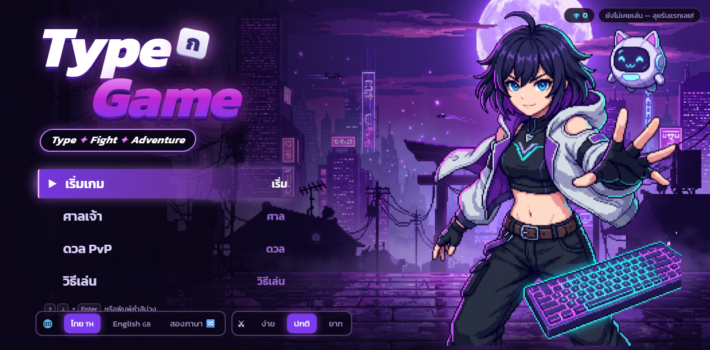
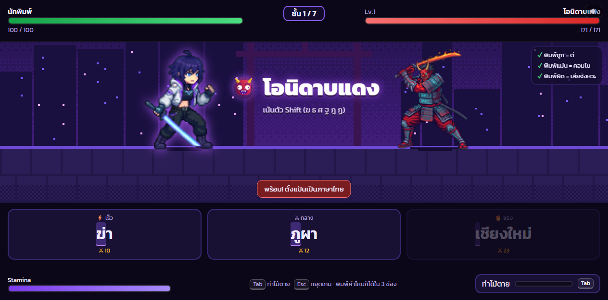
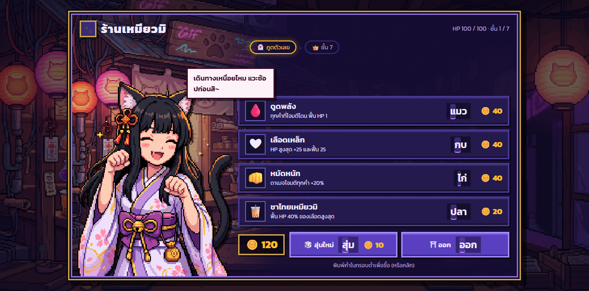
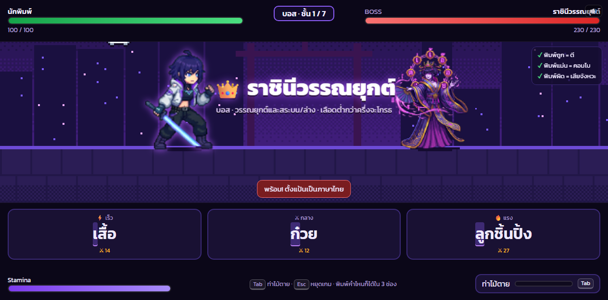
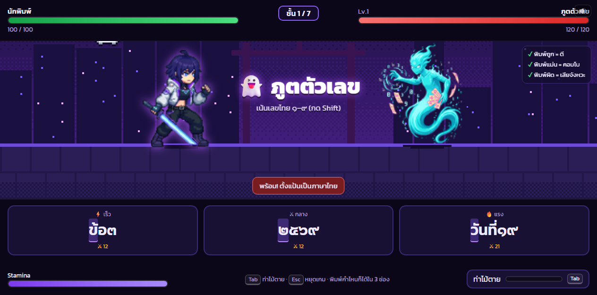

<div align="center">

<a href="https://ballg-it.github.io/type-game/"></a>

# ⌨️ Type Game

### พิมพ์เร็ว = ตีแรง · พิมพ์แม่น = คอมโบ

เกมฝึกพิมพ์แนว **ต่อสู้ 1 ต่อ 1 + Roguelike + เนื้อเรื่องเบาๆ** สไตล์พิกเซลนีออนไซเบอร์พังก์
รองรับ **ภาษาไทย (เกษมณี) 🇹🇭 · English 🇬🇧 · สองภาษา 🔀**

<a href="https://ballg-it.github.io/type-game/"></a>


</div>

---

## 🎮 เล่นยังไง

ทุกการกระทำในเกม **มาจากการพิมพ์** — ตี กัน เลือกทาง ซื้อของ แม้แต่เลือกเมนู

| | |
|---|---|
| ⚔️ **โจมตี** | มีคำให้เลือก 3 ช่อง: ⚡ เร็ว · ⚔️ กลาง · 🔥 แรง — คำยาวตีแรงกว่า |
| 🛡️ **ป้องกัน** | ศัตรูชาร์จท่า → พิมพ์คำกันให้ทัน · กันช่วงท้ายพอดี = **สวนกลับ ×2** |
| 🔗 **คอมโบ** | พิมพ์ถูกติดกัน ดาเมจคูณขึ้นเรื่อยๆ — พิมพ์ผิดตัวเดียวหลุด |
| 💥 **ท่าไม้ตาย** | เกจเต็มกด <kbd>Tab</kbd> แล้วพิมพ์ประโยคยาวให้ทันเวลา |
| 💨 **Stamina** | พิมพ์รัวมั่วๆ แรงจะหมด ดาเมจลดครึ่ง — แม่นสำคัญกว่าเร็ว |

<div align="center">

<br><sub>ไฟต์กับ 👹 โอนิดาบแดง — ศัตรูที่เน้นตัว Shift</sub>
</div>

## 🗺️ หนึ่งรัน (~15–20 นาที)

```
เมนู ─▶ แผนที่ 7 ชั้น ─▶ ⚔️ ไฟต์ · 💀 ศัตรูเก่ง · ❓ เหตุการณ์ · 🔥 จุดพัก · 🐱 ร้าน
                     ─▶ ชนะ = 🪙 เหรียญ + เลือกอัปเกรด 1 ใน 3
                     ─▶ 📖 ฉากเนื้อเรื่อง ─▶ 👑 บอส ─▶ 🎬 ฉากจบ (2 แบบ)
                     ─▶ 💎 เศษคริสตัล ─▶ ⛩️ ศาลเจ้า อัปเกรดถาวร ─▶ รันใหม่
```

<table>
<tr>
<td width="50%"><br><sub>🐱 <b>ร้านเหมียวมิ</b> — พิมพ์ชื่อสัตว์เพื่อซื้อ · เหมียวมิขยับทีละส่วน (หายใจ หางแกว่ง หูกระดิก)</sub></td>
<td width="50%"><br><sub>👑 <b>ราชินีวรรณยุกต์</b> — บอสที่ฝึกวรรณยุกต์และสระบน/ล่าง เลือดต่ำกว่าครึ่งจะโกรธ</sub></td>
</tr>
</table>

## 👾 ศัตรู

| | ศัตรู | ฝึกอะไร | HP |
|:-:|---|---|:-:|
| 🔨 | **โจรค้อนคีย์** | แป้นแถวบน | 110 |
| 👻 | **ภูตตัวเลข** | เลขไทย ๑–๙ / ตัวเลข (กด Shift) | 120 |
| 👹 | **โอนิดาบแดง** | ตัว Shift (ฆ ธ ศ ฐ ฎ ฏ) / ตัวพิมพ์ใหญ่ | 150 |
| 👑 | **ราชินีวรรณยุกต์** *(บอส)* | วรรณยุกต์ สระบน/ล่าง · มีคำกันเอง | 230 |

<div align="center">

<br><sub>👻 ภูตตัวเลข — ต้องพิมพ์เลขไทยอย่าง <code>๒๕๖๙</code></sub>
</div>

## ✨ ฟีเจอร์

- 🇹🇭 **ภาษาไทยเต็มรูปแบบ** — สลับลำดับวรรณยุกต์/สระบน-ล่างได้ตามที่คนพิมพ์จริง · พิมพ์ผิดภาษาแป้นจะเตือน ไม่นับผิด
- 🔀 **3 โหมดภาษา** ไทยล้วน · อังกฤษล้วน · สองภาษาสลับกลางไฟต์ — ภาษาเมนูกับภาษาที่พิมพ์ตั้งแยกกันได้
- 🎚️ **3 ระดับความยาก** ง่าย · ปกติ · ยาก
- 🃏 **อัปเกรด 11+ แบบ** รวมอัปเกรดผูกกับตัวอักษร เช่น "คำที่มี ก ดาเมจ ×2"
- ⛩️ **ศาลเจ้า** แต้มถาวร 7 แบบ เซฟในเบราว์เซอร์
- 📖 **เนื้อเรื่องที่ต้องพิมพ์** ก่อนบอส บทเปลี่ยนตามสถานะผู้เล่น + **2 ฉากจบ** 🤝 / 🔒
- 🆚 **ดวล PvP ออนไลน์** — รหัสห้องเป็นชื่อสัตว์ 3 คำ หรือส่งลิงก์เชิญ ไม่ต้องมีเซิร์ฟเวอร์ (PeerJS)
- 🎨 **อาร์ตพิกเซล** ไอริน 35 เฟรม · ศัตรูวาดท่าสู้ · เอฟเฟกต์ท่าจาก [pixelfx](https://github.com/patch-gg/pixelfx) · hit stop + จอสั่น

## 🚀 เริ่มเล่น

**ออนไลน์:** 👉 **[ballg-it.github.io/type-game](https://ballg-it.github.io/type-game/)**

**ในเครื่อง:** ไม่มีขั้นตอน build — โคลนแล้วเปิด `index.html` ได้เลย

```bash
git clone -b ccr-a67b83da-eggwh5 https://github.com/ballg-it/type-game.git
cd type-game
python -m http.server 8000   # แล้วเปิด http://localhost:8000
```

> 💡 ตั้งแป้นพิมพ์เป็นภาษาไทย (เกษมณี) ก่อนเล่นโหมดไทย · เลือกเมนูได้ทั้ง <kbd>↑</kbd> <kbd>↓</kbd> <kbd>Enter</kbd> หรือพิมพ์คำที่เห็น

## 📁 โครงสร้าง

```
index.html      ตัวเกมทั้งหมด (HTML/CSS/JS ไฟล์เดียว)
sprites.js      เอนจินสไปรต์พิกเซล
pixel.html      แกลเลอรีสไปรต์ + ฉากเดโม
art/            ภาพหน้าเมนู · เฟรมไอริน · ศัตรู · ร้าน
vendor/         pixelfx (MIT) bundle
tools/          สคริปต์ตัดพื้นเขียว / แยกเฟรม / ย่อให้ลงตารางพิกเซล (Python)
tests/          สคริปต์ทดสอบจำลองการพิมพ์ (Playwright / Chrome DevTools)
docs/IDEAS.md   เอกสารไอเดียเกมฉบับเต็ม
HANDOFF.md      สถานะการพัฒนา + โน้ตทางเทคนิค
```

## 🛣️ ต่อจากนี้

- [x] ไฟต์ ตี/กัน/คอมโบ/ท่าไม้ตาย · ศัตรู 3 แบบ + บอส · อัปเกรด · แผนที่สุ่ม · ร้าน · เนื้อเรื่อง · ศาลเจ้า · PvP
- [x] เอฟเฟกต์ `pixelfx` ให้ศัตรูทุกตัวตามสีธีม + ประกายใบดาบไอริน
- [x] บอสใหม่ 4 ตัว + โหมดท้าดวลบอส: กระจก 🪞 · ล่องหน 👁️ · สลับแป้น 🔄 · แฝด 👯 (หมุนเวียนในรันหลังชนะครั้งแรกและ Endless)
- [x] โหมด Endless ♾ (สู้ไม่รู้จบ ทุก 5 ด่านเจอบอสหมุนเวียนทั้ง 5 ตัว + ร้าน · เก็บสถิติด่านไกลสุด)
- [x] ระบบธาตุ (🔥/💧/🌪️) · คำหลอก (☠️) · คัตซีน 4 องก์ (เปิดเรื่อง · กลางทาง · ก่อนบอส · ฉากจบ + โรงฉายคัตซีน)
- [x] เมนูหยุดเกม (เล่นต่อ · เล่นใหม่ · กลับ Lobby) + ระบบเซฟความคืบหน้าให้กลับมาเล่นต่อจาก Lobby ได้
- [ ] บาลานซ์ตัวเลขจากการเล่นจริง

ไอเดียทั้งหมดอยู่ใน **[docs/IDEAS.md](docs/IDEAS.md)**

## 🙏 เครดิต

- เอฟเฟกต์ท่า: [pixelfx](https://github.com/patch-gg/pixelfx) (MIT) — ดู [`vendor/pixelfx-NOTICE.md`](vendor/pixelfx-NOTICE.md)
- ดวลออนไลน์: [PeerJS](https://peerjs.com/)
- อาร์ตตัวละครและฉาก สร้างด้วย AI (Google Gemini) แล้วปรับให้ลงตารางพิกเซลด้วยสคริปต์ใน `tools/`

<div align="center"><sub>Made with ⌨️ + 💜</sub></div>
